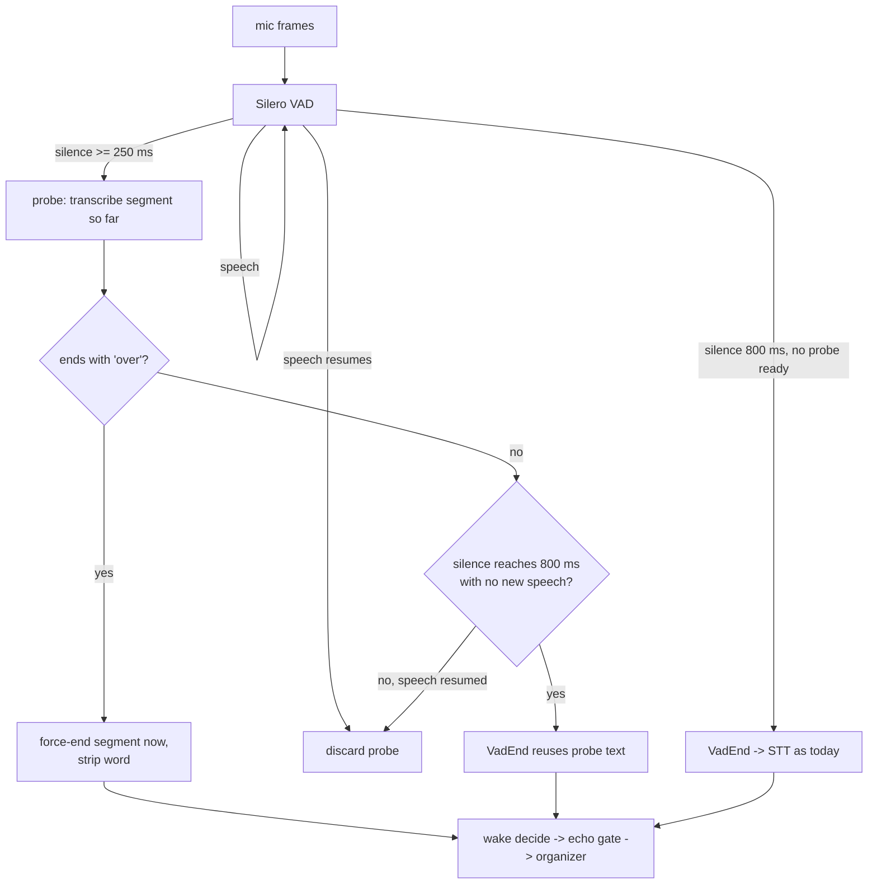

# DESIGN - spoken end-of-turn word ("over") and speculative transcription

Status: DRAFT 18-11-2026, awaiting roster review and the user's sign-off.

## Problem

After the user stops talking GLaDOS waits for `silero_min_silence_ms` (800 ms)
of silence, then transcribes (about 2 s on prod CPU today), then thinks. The
user asked for a walkie-talkie word: say "over" and the turn ends at once.

Measured 18-11-2026 (prod log, one-second resolution): hangover 0.8 s, STT ~2 s,
LLM ~1 s, plus tools (Dunnes search 3.5 s) and synthesis (not logged until
the per-turn latency line from this branch is deployed).

## Constraints

- The VAD only reports start/end; nothing hears words until STT runs, and STT
  is batch (`transcribe(pcm) -> str`). There is no streaming ASR.
- A keyword-spotter for "over" (openWakeWord-style) would need a trained model
  for a short, common word ("game over", "hand it over", "clover") - rejected.
- STT runs serially behind one lock. On CPU a probe costs ~2 s, longer than
  the hangover it is meant to beat, so everything below needs Whisper on the
  GPU (item 1 on this branch) and is OFF on a CPU STT.
- Wake gating, the TTS echo gate and VadEnd-order dispatch must be unchanged.
- Raising the hangover cut people off mid-sentence once (20-08-2026); the
  design must not shorten it for people who do not say the word.

## Proposal

Two layers. The second is the user's request; the first is what makes it cheap
and is the larger win on its own.

1. **Speculative transcription at a pause.** When speech has been silent for
   `probe_after_ms` (250 ms) inside a segment, transcribe the segment so far
   in the background. If the hangover then completes with no new speech, the
   VadEnd reuses that transcript instead of running STT again: STT leaves the
   critical path on every turn. If speech resumes, the probe result is thrown
   away (a later pause probes again).
2. **End word.** If the probe transcript ends with the end word (default
   "over", trailing punctuation ignored, at least one other word before it),
   the VAD force-ends the segment immediately, the word is stripped, and the
   probe transcript is the utterance. Nothing changes for turns without it.

Expected effect with GPU STT (~0.3 s): plain turn 1.1 s -> ~0.8 s to text;
"over" turn ~0.55 s after the word, i.e. ~0.2 s better than layer 1 alone once
the time to say the word is counted. The value of the word is mostly control,
not speed: it would let us later RAISE the hangover for slow speakers without
taxing people who say "over".

## Open questions for the user

1. The word itself: "over" collides with "hand it over" / "is it over" if the
   user pauses right after. Ending the turn there is harmless (the pause would
   probably have ended it anyway), but STRIPPING it changes the meaning.
   Options: strip only when the word follows a pause inside the segment; use a
   rarer word ("over and out", "GLaDOS over"); or keep "over" and accept it.
2. Ship layer 1 alone first and measure with the latency line, then decide on
   layer 2?

## Not in scope

- Streaming ASR; semantic "is this request complete" endpointing by the LLM.
- Changing the hangover value.

## Roster review 18-11-2026 (architect, concurrency/QA, UX, clean-slate)

Must-fix before any build:

1. **Privacy (ARCH 3.2).** A probe transcribes mid-segment, before the wake
   decision at VadEnd. In a wake-gated room (the kitchen) that is
   transcribing un-woken speech, which the invariant forbids even if the text
   is discarded. Options: probe only while the room is already armed (needs a
   non-consuming `would_admit` peek; `decide` consumes), or no probes in
   wake-gated rooms. Either is an ARCH decision for the user.
2. **Echo first.** Probes must pass the same echo check as VadEnd, or TTS
   bleed occupies STT, and a bleed of GLaDOS saying "...over" could end a turn.
3. **STT scheduling.** Whisper is one lock shared by all rooms, run in a
   thread: cancelling a probe does not stop or dequeue it. Need at most one
   probe per connection (generation counter checked after acquiring the
   lock), VadEnd transcriptions ahead of probes (non-blocking try-acquire for
   probes), and the CPU gate enforced in code from the STT factory.
4. **Reuse keyed on exact audio.** Reuse a probe only if the VadEnd slice has
   the same start and ends within the probed range; VadEnd while a probe is in
   flight awaits it instead of a second STT call.
5. **VAD contract, additive.** `VadPause(pcm, seq)` event (a VAD that cannot
   pause never emits it) and `end_now(seq)`, idempotent, reusing the force-cut
   path; never `reset()`. Pause from the existing iterator's silence tracking
   (wrapped, pinned by a test), not a second iterator.
6. **Stripping changes meaning** ("is it over" -> "is it"). End the turn on the
   word, but strip it only when a measured gap precedes it; otherwise leave it
   in. Measure Whisper on ~20 recordings per speaker before building layer 2.

Found in passing, independent of this design: **the Silero model is shared
across all VAD instances and is stateful** (`VADIterator.reset_states()` calls
`model.reset_states()`), so two mic connections corrupt each other's speech
detection today, and a reset in one room wipes the other. Fix: one model per
`SileroVAD`.

Cross-lens agreement: ship layer 1 (and GPU STT) first; layer 2 is a control
feature, about 0.2 s net, not a speed feature. Clean-slate and UX both rank
two levers this design omits above the end word: a "turn accepted" earcon
(through the echo gate) plus a spoken acknowledgement before slow tools, and
sentence-streamed TTS from the LLM. Clean-slate would replace the end-word
check with a pluggable completeness predicate (end word as one rule).

Diagram not yet re-rendered for these changes (no mermaid renderer on this
box).
