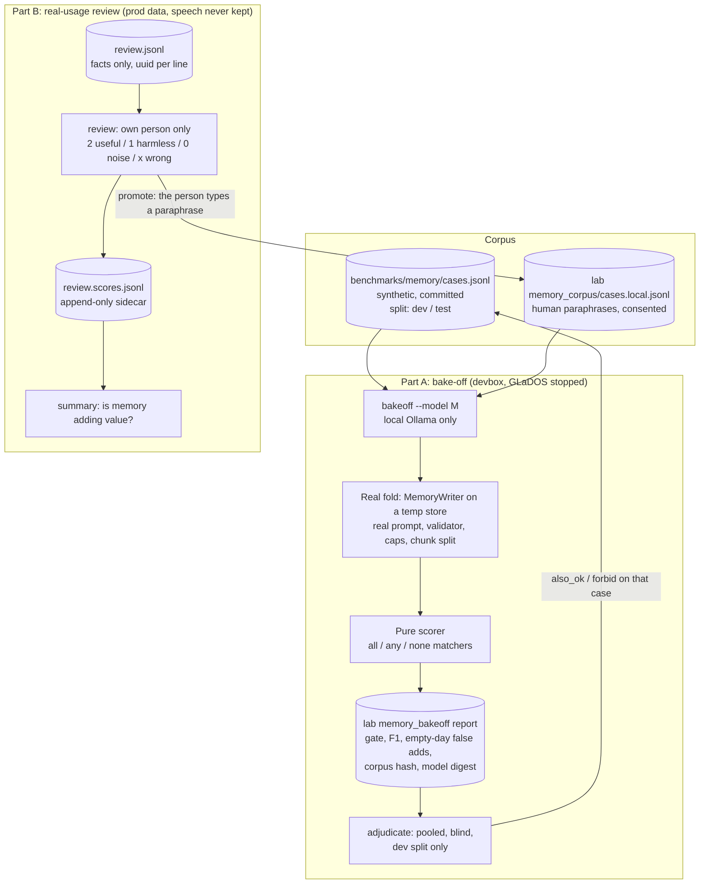

# DESIGN - memory-writer scorer and review scoring

Status: signed off 18-10-2026 after a four-seat design roster (architect,
security/privacy, measurement validity, clean slate). First slice (items 1-3)
built; not yet run on a real model (the devbox GPU was needed elsewhere).

## The problem

Per-speaker memory (DESIGN-speaker-memory.md) runs in shadow: a nightly
writer call proposes facts, the validator filters them, and nothing is fed
back to a turn. Two questions need evidence before anything changes:

1. **Which writer?** Any Mistral-family model that fits, and 30 notes per
   call versus 1. Needs a labelled corpus and a scorer you can trust.
2. **Is memory worth it?** Needs a human verdict on the facts real usage
   produces, without keeping the speech that produced them.

## Shape

## Part A - labelled corpus and scorer

- **Corpus.** `benchmarks/memory/cases.jsonl`, committed and synthetic only;
  real-derived cases go in `<lab-root>/glados/memory_corpus/cases.local.jsonl`.
  One case per line: `id`, `split` (`dev` | `test`, frozen before the first
  model run), `origin` (`synthetic` in the committed file, enforced by a
  test), `tags`, `known` (fact texts), `notes` (`said`, `reply`,
  `untrusted`), optional `max_notes_per_batch`, `expect_add`, `expect_drop`
  (by text in `known`), `forbid`, `also_ok`.
- **Matchers.** `{"all": [...], "any": [...], "none": [...]}` over the same
  normalisation the validator dedupes with. `none` catches negation and the
  wrong person ("not", "partner", "used to"), which bare keyword bags count
  as hits. A produced fact satisfies at most one expectation (sorted, one to
  one).
- **Runner.** `python -m glados.memory bakeoff --model M`. It drives the REAL
  `MemoryWriter` fold on a temp `SpeakerMemoryStore`: chunk split, sequential
  `known`, persisted day caps at the configured values, enrollment stubbed
  true, no re-warm. It does not reimplement the loop. It refuses any backend
  other than `ollama` and any host off loopback/LAN (the same positive
  locality rule as injection). It refuses to run while GLaDOS answers on
  :8765. It unloads the previous model (bake-off `keep_alive` override) and
  records the effective `num_ctx`, `num_predict`, `think`, model digest and
  corpus hash. `replay` folds into this in a separate commit.
- **Score.** On the accepted output (what would be stored), with the raw
  output alongside: recall on expected adds and drops, unexpected facts (kept
  as unadjudicated, not counted wrong), forbidden hits, validator rejections
  by reason, latency.
- **Decision.** Gate: zero forbidden hits on the test split. A forbidden hit
  is a veto, reported per case. Rank: F1 on the test split, shown with the
  false-add rate on nothing-qualifies days, which should be at least 40 % of
  the corpus because they are the common real day. Tie-break: p90 warm
  latency. The shipped writer is the baseline row in every report.
- **Adjudicate.** Run every model first, then judge the pooled unexpected
  facts blind (no model label, random order), dev split only. The verdict
  goes to that case's `also_ok` / `forbid` in the file the case came from,
  never from a local case into the committed file. Then re-score every model
  on the same corpus version.
- **Reports** live out of repo under `<lab-root>/glados/memory_bakeoff/`,
  owner-only: they hold model output derived from local cases.

Deferred until two models are actually compared: `--repeat` with seed and
flip rate, bootstrap intervals and paired tests, the 30-versus-1 chunking
comparison (same notes, same `known`, one budget per simulated day, long-day
family only), per-tag tables beyond counts.

## Part B - review scoring

- Review lines gain a random uuid4 `id` (and `untrusted` on every kind).
  Scores go to an append-only sidecar `review.scores.jsonl`, so the CLI never
  rewrites the file the server appends to. A trailing partial line is
  skipped.
- `python -m glados.memory review --person P` shows only that person's facts
  by default (reading another member's facts is itself a privacy read), and
  scores them 2 / 1 / 0 / x. `summary` prints the distribution per kind,
  person and week: the answer to "is memory adding value". The same session
  asks "anything I should have remembered?", the recall signal a facts-only
  log can never give.
- **Feeding the corpus: option (iii), human paraphrase.** All three seats
  rejected keeping the speech. That option breaks the 2-day retention promise
  and the "review holds no speech" rule, and `forget`/`wipe` would miss it.
  So on `promote`, the person types a paraphrase of what they said. It is
  defanged like a note and written to `cases.local.jsonl` with
  `origin: "real-paraphrase"`, a `spkN` label (never a name) and a consent
  stamp. Only a person listed in the local corpus manifest's
  `consented_persons` can be promoted. Livingroom facts are not promotable by
  default.
- `forget`, `forget-session` and `wipe` also purge the matching lines in
  `review.scores.jsonl` and the person's `cases.local.jsonl` cases, so fact
  text that spread into the sidecars goes too.
- The corpus dir gets the STT corpus treatment: README with consent, checked
  not cloud-synced, owner-only, and a delete-my-cases command. A test rejects
  committed cases that contain any token from the gitignored household
  lexicon.

## First slice

1. ~20 synthetic cases (self fact, request-not-fact, empty days, a drop, a
   reaffirm, an injection, an untrusted cap case), split dev/test.
2. Pure scorer module (`glados/memory/scoring.py`), unit-tested.
3. `bakeoff --model M` over the real fold, with the locality refusal, JSON
   plus markdown report out of repo, and corpus hash and model digest.
4. Then Part B: ids, `review`, `summary`, sidecar.
5. Then `promote` and `adjudicate`.
