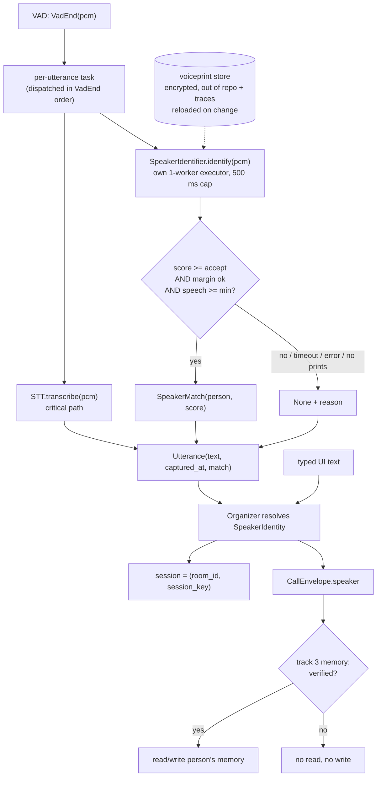

# DESIGN - speaker identity (ARCH v5)

Status: slices 1-2 BUILT (signed off 17-10-2026, fallback option: session
keyed on default_user, `person` None). Slice 3 open. Reviewed by the design
roster (clean-slate, architect, security, concurrency) on 17-10-2026.

Built differently from the plan below: the identifier is shared by every
mic, so its one-at-a-time limit is house-wide, not per room (a second room
speaking during a ~30 ms embed gets `busy`). Per-room candidate lists and
forwarding the envelope to MCP servers are not built yet.

## The problem

Every turn's `speaker_id` is `ClientBinding.default_user`, which is `"qcko"` on
every client: a real person. Track 3 (long-term memory) keys on `speaker_id`,
so the moment it lands, a guest's turn would read and write qcko's memory.
v5 identifies who spoke from the utterance audio, and when it cannot tell, it
says so instead of guessing.

## Published interface (track 3 builds on this)

One frozen value type, defined in `src/glados/core/speaker.py`. Nothing else
is the contract.

```python
SpeakerSource = Literal["voice", "fallback", "typed"]

@dataclass(frozen=True)
class SpeakerIdentity:
    person: str | None        # an ENROLLED person, or None. Never a guess.
    session_key: str          # what the session is keyed on (see below)
    source: SpeakerSource     # voice = identified by voiceprint;
                              # fallback = voice turn, not identified;
                              # typed = UI text, the client binding's user
    score: float | None       # cosine of the accepted match (voice only)

    @property
    def verified(self) -> bool:   # True only for source == "voice"
```

- `person` is the field a consumer reads to mean "who is this". It is `None`
  for every unidentified voice turn, so no consumer can mistake a fallback for
  qcko by forgetting to check a flag.
- `session_key` is `person` when verified, else the binding's `default_user`.
  This keeps today's session continuity in a room: a short "yes" that cannot
  be identified does not split the conversation. It is a bucket name, not an
  identity, and must never be used to choose whose data to touch.
- `typed` turns carry `person = binding.default_user` but `verified = False`:
  a desk login is a different trust context, not proof of who is typing.
- **Track 3 obligation:** memory reads and writes happen only when
  `identity.verified` is True, for `identity.person`. Everything else is
  fail-closed: no read, no write.
- Carried on the turn (`CallEnvelope.speaker`, with `speaker_id` kept as a
  derived alias of `session_key` so current callers keep working). It never
  carries an embedding.

## The flow



## Decisions

1. **Model.** A speaker-embedding model exported to ONNX (WeSpeaker ResNet34
   or ECAPA-TDNN), run on CPU through the onnxruntime already in the lockfile.
   Resemblyzer is a bake-off alternative only (unmaintained, adds librosa).
   The pick, and the thresholds, come from an offline bake-off on household
   clips recorded through the kitchen phone itself, including impostor clips
   (guests, TV, GLaDOS's own TTS). Gates: impostor acceptance <= 1% at the
   chosen threshold, and STT p50/p95 not slower with identify running.
2. **Decision rule, open-set.** Accept the best enrolled person only if cosine
   >= `accept_threshold`, best minus runner-up >= `margin` (with one enrolled
   person the runner-up is taken as 0), and voiced length >= `min_speech_s`.
   Otherwise `None` with a reason from a closed set: `low_score`,
   `low_margin`, `too_short`, `timeout`, `error`, `no_prints`, `off`.
   Optional per-room candidate lists in `rooms.toml` (recommended).
3. **Where it runs.** In the audio pipeline, the only holder of the pcm,
   concurrently with STT on the same utterance. The pipeline never decides
   policy; the Organizer never sees audio. Identify runs on its own
   single-worker executor with onnxruntime capped at 1-2 intra-op threads, so
   a slow identify can neither starve the executor whisper uses nor delay
   the transcript beyond the 500 ms cap. A turn waits at most 500 ms for
   identity, and only while STT is still running anyway.
4. **Ordering.** Each utterance's match travels with its text in one
   `Utterance` struct (no "last match per client" state). Dispatch is
   serialised per pipeline in VadEnd order, because a variable identify time
   would otherwise reorder back-to-back utterances. The struct is also the
   seam the wake-word track adds its own field to.
5. **No adaptation.** Prints change only by an explicit enroll. Learning from
   turns is how a misidentification becomes permanent.
6. **Barge-in stays room-scoped.** Anyone's "stop" cancels the room's turn and
   clears its queue, whoever started it: one shared speaker, one stop.
   The room FIFO still runs one turn at a time.
7. **Not an authorisation input (until v6).** Voice confirmations stay
   room-scoped; no permission, confirm or user-scoped write branches on
   identity. A voice can be replayed; v6 owns access control. A test pins
   this. Spoken confirms log the matched person and score for audit only.
8. **Feature flag.** `[speaker_id] backend = "off"` by default, so prod is
   unchanged until the bake-off has set thresholds. With "off" or an empty
   store, nothing is embedded at all.

## Privacy (ARCH section 9)

Voiceprints are biometric data (GDPR Art. 9).

- **At rest:** one file per person, encrypted with a key held in the OS
  keyring (`glados.voiceid` / `store-key`), under a directory set by config or
  `GLADOS_VOICEID_DIR`, outside the repo and outside `traces/`. Atomic writes.
  Excluded from any future backup scope unless that backup carries the key.
- **Contents:** the enrollment embeddings, their centroid, `model_id` (model
  name plus a hash of the model file, so a re-export invalidates prints), and
  a consent record (who, when). No audio is kept. Prints with a different
  `model_id` are skipped with a "re-enroll needed" warning, never compared.
- **Turn-time embeddings** are compared and discarded. They never reach logs,
  traces, the admin viewer, the LLM prompt, or any MCP envelope. The vector
  type has a redacting `repr`. Traces get person, score and reason only.
- **Enrollment** is a server-side CLI only: `python -m glados.voiceid enroll
  <person> <wav...>`, `list`, `forget <person>`. Enroll refuses an existing
  person without `--replace`; ids are checked against configured users; every
  enroll/replace/forget is audit-logged (id, model, time). Never an MCP tool,
  never a voice command.
- **Forget** takes effect without a restart: the server reloads the store on
  change and swaps an immutable snapshot. Purging what track 3 stored for that
  person is track 3's job, triggered by the same command.
- **Outbound:** when the envelope is finally forwarded to MCP servers, third-
  party servers get no identity; only first-party ones get `person`.

## Slices

1. Contract: `SpeakerIdentity`, `Utterance`, Organizer resolution; pipeline
   always passes `None`. Behaviour no-op, interface live for track 3.
2. Identifier + encrypted store + CLI + fake embedder, behind `backend="off"`;
   all tested on fake vectors.
3. ONNX backend + bake-off (devbox GPU queue not needed, CPU) to set
   thresholds; turn on for the kitchen with the user's OK.

## Known limitations

- A short reply cannot be identified, so it lands as `fallback`. That costs
  nothing for conversation (same session) but means it is not remembered.
- A misidentification between two enrolled people would key the turn to the
  wrong person. Threshold + margin + per-room candidates keep it rare; it is
  why identity is never an authorisation input.
