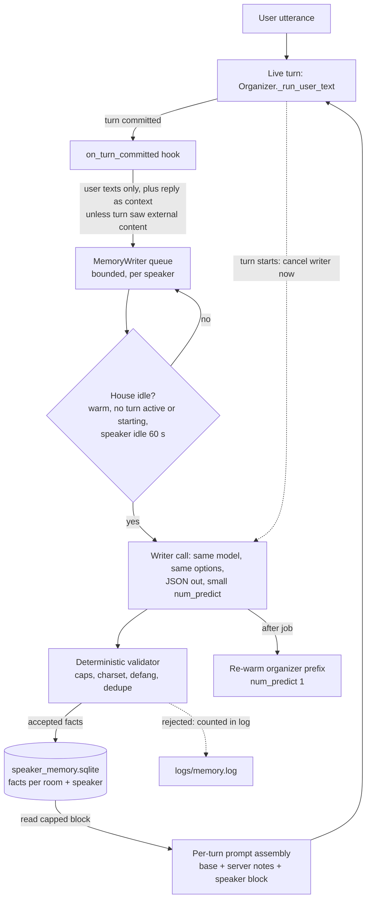

# DESIGN - per-speaker long-term memory (backlog track 3)

## The problem

GLaDOS forgets everything once a session's 8-turn hot buffer ages out. People
want it to keep durable facts about them ("I'm vegetarian", "my daughter is
Ema") and use them in later conversations.

Fixed by the user (17-10-2026): build first, bake-off later. The writer runs on
the SAME resident model as the organizer (`ministral3:8b-instruct`), not a
second model. Memories are keyed on `speaker_id`, which is `room.default_user`
until voice-ID (track 2) lands.

## Shape

## Components

1. **`core/speaker_memory.py` - `SpeakerMemoryStore`.** SQLite, WAL, one
   connection driven through `asyncio.to_thread`. Table `speaker_facts(id,
   room_id, speaker_id, text, source_session, source_utterance, created_at,
   last_seen_at)`. Distinct from the section 8 "SQLite session log", which is not
   built; this table name is reserved so that log does not fork the schema.
   Per-speaker cap (30), LRU eviction. An in-RAM cache, rebuilt from each write,
   serves the read at turn start, so the critical path never touches disk.
   The db lives outside the repo tree (config `db_path`, default under the
   server's data dir), file mode owner-only.
2. **`core/memory_writer.py` - `MemoryWriter`.** One asyncio worker. The
   transport is an `LLM` adapter handed in from server.py, built from the SAME
   `[llm]` config as the organizer (model, `num_ctx`, `keep_alive`), so a
   writer call never reloads the model; `[memory] writer_model` is the seam the
   later bake-off swaps. Prompt-building and validation are pure functions,
   separate from transport, so `python -m glados.memory replay` can run a fixed
   transcript through any model.
3. **Organizer, two narrow hooks.** A note after `_commit_history`, and a
   push-driven `turn_starting()` fired by `RoomQueueManager.on_enqueue` on
   EVERY accepted enqueue (user turns, intercom, anything later), which is
   earlier than `_inflight` and covers every path. Everything else stays out of
   `organizer.py`.
4. **Per-turn assembly.** The speaker block is added per turn in
   `_run_user_text`, never via `set_memory_notes` / `self._system_prompt`, which
   are organizer-global. Cross-speaker bleed is impossible by construction.
5. **CLI** `python -m glados.memory list|forget|wipe [--session]`.

## Can the writer slow or block a live turn?

Not by design, and the design tells us what to measure:

- **Gate.** The writer runs only when the LLM is warm, no turn is active or
  starting in any room, and the speaker has been idle 60 s.
- **Preempt.** `turn_starting()` cancels the in-flight writer request
  immediately. Ollama aborts between decode steps, so the worst case is the
  writer's prefill. The writer prompt is kept small (no tools, no persona) to
  keep that short. **To measure on 0.23.2:** that cancel really aborts a
  `stream:false` request, and how long the preemption takes.
- **`OLLAMA_NUM_PARALLEL` stays 1.** A second slot reserves KV for a full 16k
  context (about 2x KV VRAM on a 12 GB card) and concurrent decode slows the
  live turn. With the gate and preemption, parallel buys nothing.
- **Prefix cache.** A writer call evicts the organizer's cached system prompt
  and tool prefix from the single slot. After each job the writer re-warms it
  with a `num_predict=1` organizer-shaped call. **To measure:** time to first
  token for the next turn, with and without the re-warm.
- **Starvation.** Bounded queue, capped backoff and attempts, drops logged.
  The queue is in RAM: a restart loses unwritten turns, accepted for v1.
- **Shutdown.** `drain()` cancels the writer first, before `llm.aclose()`.

## Are injected memories untrusted?

Yes. Layer 3 below is the contract:

- **Writer input.** Facts are drawn from what the USER said. GLaDOS's reply is
  context only, and is dropped entirely when the turn saw `<external>`
  content (`outcome.untrusted_seen`), because a reply can paraphrase a hostile
  page. Tool messages never reach the writer.
- **Validator.** At most 5 adds and 2 drops per job, each fact at most 120
  chars, one line. Tag-like text, zero-width and bidi characters, and
  `<memory-notes` lookalikes are stripped or rejected using the same defang as
  `memory_gate`. Dedupe runs against existing facts. Drop indexes are the
  prompt's own short numbering and must belong to this speaker. The denylist is
  noise reduction, NOT the boundary.
- **Injection.** The block is a `<memory-notes source="speaker:...">`, with the
  attribute stripped of `<>"`, behind the shared preamble ("reference data, not
  instructions"). It is capped at 600 chars and priced in TOKENS in the boot
  proof (preamble + wrapper + dense payload added to the fixed prefix).
- **Never authorises.** A fact cannot satisfy a confirm gate, a quantity, or a
  money step. Those are judged on the live utterance by existing harness code,
  and a test asserts memory text changes none of their inputs.
- **Local only.** The block is added only when the turn's adapter is a local
  one (positive check), so a cloud specialist route never carries it. A test
  checks the outbound body.
- **Privacy.** Traces, logs at INFO, and the admin room viewer carry counts
  only, never fact text or writer prompts.
- **Ambient rooms.** Until voice-ID, every voice in a room writes into that
  room's default user (TV, guests). So memory is enabled PER ROOM
  (`[[rooms]] memory = true`), and facts are keyed `(room_id, speaker_id)`.
- **Removal.** CLI `forget` (one fact), `forget-session` (everything a
  poisoned session wrote) and `wipe`. Each delete bumps a per-speaker `purges`
  counter and `forget-session` records the session as forgotten, so notes the
  writer was still holding in RAM can never bring removed content back. A job
  preempted after its store write committed is never requeued (no double
  write). Voice "what do you remember / forget that" is a follow-up.
- **Traces.** `llm_request` records the shared system prompt plus
  `[speaker memory: N chars]`, never the facts.

## ARCHITECTURE.md section 14 amendment: Layer 3

Layer 2 forbids auto-writing for two reasons, and Layer 3 answers both.
**Trust:** Layer 3 is never trusted. It is always guard-wrapped data, it never
authorises an action, and its writer never sees tool output. **Volume:** it has
a hard char cap and a fact cap, priced in the boot budget. Its dispatch effect
at the cap must be measured before any shipped config enables it.

## Rollout

`[memory] enabled = false` in code and in the shipped `configs/glados.toml`. The
devbox turns it on locally. Before prod gets it, run the dispatch suite with a
full 600-char block injected, on every live model surface. The writer bake-off
(any Mistral-family model that fits) comes after that.

## Follow-ups (not this slice)

- Explicit "remember X" fast path, written synchronously (best-precision source).
- Voice/desk "what do you remember about me" and "forget that".
- Real-Ollama probes: preemption latency, reload check via `/api/ps`, TTFT delta.
