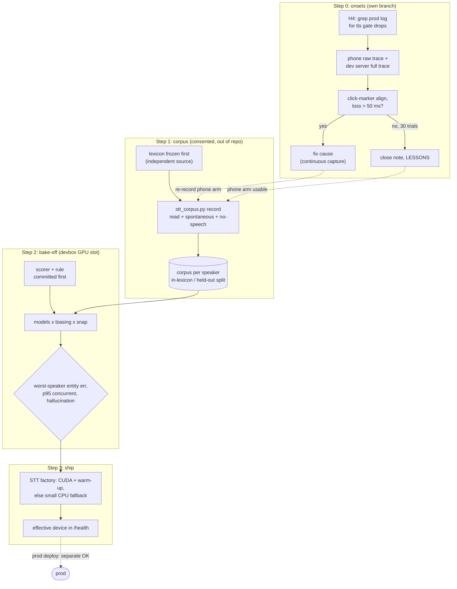

# DESIGN - STT fit to our voices (backlog track 4)

Status: REVISED after design roster (architect, QA/measurement, security,
clean-slate), awaiting user sign-off. Nothing built, no GPU run yet.

## Problem

Speech-to-text mangles household speech: our accents (Czech-accented English,
Irish English) and our vocabulary (product names, people, "GLaDOS", "Dunnes").
The only knob today is `whisper_hotwords = "GLaDOS Dunnes"`.

Facts measured 17-10-2026:

- Prod runs `distil-small.en`, **CPU int8**, beam 1, `language = "en"`.
- Prod's **RTX 3070 Ti (8 GB) is idle** (675 MiB used); Ollama is on the
  R9700. A much larger ASR model fits there without touching the LLM card.
- **No corpus of our voices exists.** Prod overrides `wav_traces = false` in
  `glados.local.toml`; the committed default is `true` but `traces/` is
  gitignored. `scripts/stt_benchmark.py` + `audio/stt/wer.py` exist, tested.
- Devbox bake-off GPU: RTX 3080 Ti 12 GB, shared turn-by-turn with track 3.
- STT contract in code is `transcribe(pcm: bytes) -> str`; ARCH section 6 still
  shows a streaming signature (drift, fixed in this slice's doc update).

Dropped onsets (half-open since 15-06-2026): server VAD measured 0 ms onset
loss on injected audio (SESSION 2026-08-20), so if real it is on the CLIENT
capture path (Android `module-sles-source` -> `parec` -> `Resampler` ->
`BoundedAudioQueue` -> ws).

## Goals and done

1. A consented, out-of-repo corpus of household voices with references.
2. A pre-registered bake-off that picks the STT configuration on **entity
   accuracy of the worst speaker, latency under contention, hallucination**.
3. Ship the winner: config + CUDA backend factory with a safe CPU fallback.
4. Dropped onsets: measured, and fixed or closed - **on its own branch**.

Done = merge-ready branch(es), results in `<lab-root>/glados/stt_bakeoff_<date>/`,
SESSION.md entry. Prod deploy is a separate go-ahead.

## Non-goals (this slice)

- Czech-in / multilingual (corpus can record some for later).
- Fine-tuning (LoRA). Gate: only if the best zero-training config leaves the
  worst speaker above the bar; we have minutes of audio, LoRA wants hours.
- **Shipping per-speaker biasing.** It is MEASURED (corpus is speaker-labelled)
  but not shipped: it changes the STT Protocol (per-call bias) and puts
  `speaker_id` serially before STT, and a wrong `speaker_id` would leak one
  person's vocabulary into another's transcript. If it wins clearly it becomes
  its own slice with track 2.
- module-echo-cancel AEC (its own v3 slice).

## Plan

Order: onset check first (it can corrupt phone-path data), corpus, bake-off,
ship. Steps 0 and 1a need no GPU and can run in parallel.

### Step 0 - onsets (own branch `claude/stt-onsets`, no GPU)

0.1 **H4 log check first** (free): grep prod `glados.log` for
    `tts gate: dropped audio` near user-reported misses. Read-only.
0.2 Phone-side opt-in raw trace, `capture_trace` in room config, default off,
    written to Termux private `$HOME` (never `~/storage/shared`), size cap,
    deleted when step 0 closes. Server side: dev instance `wav_traces = true`
    traces the FULL inbound stream (pre-VAD), not only VAD segments.
0.3 Alignment by a **deterministic acoustic marker** (a click played before
    each trial), both streams at 16 kHz, not speech-onset judgement. Loss =
    onset-energy offset between aligned streams; threshold **> 50 ms** fixed
    before measuring.
0.4 Hypotheses, test order: H1 Android capture preset AGC/NS ramp (visible in
    raw trace); H2 queue drop-oldest at stream start/reconnect (`drops`
    counter); H3 Silero late on soft far-field onset beyond the 200 ms pad.
0.5 Remedy if H1/H2: client keeps capturing continuously (stream never
    restarts per utterance). Closure if nothing reproduces: 30 trials, which
    catch a >= 10 % per-turn drop rate with ~95 % probability; write it to
    LESSONS.md and close the memory note.

### Step 1 - corpus (no GPU)

- **Consent**: each speaker agrees per recording session; anyone can delete
  their folder; corpus under `<lab-root>/glados/stt_corpus/` (check not
  cloud-synced), labels are `spk1..n`, never names in logs or filenames.
- **Bias lexicon frozen BEFORE recording** from an independent source: the
  household names + Dunnes order history/catalogue + GLaDOS terms. Lives in a
  gitignored local file (tracked `stt_lexicon.example.txt`).
- `scripts/stt_corpus.py record`: one prompt at a time, 16 kHz mono PCM16,
  `manifest.jsonl` with `text`, `speaker`, `mic`, `entities`, `split`.
- Per speaker: ~100 read prompts (household-shaped requests) of which **30 %
  use entities NOT in the lexicon** (held-out), plus **~15 spontaneous** clips
  from scenario cards (no script). Shared: **>= 30 no-speech clips** (TV,
  kitchen noise, music, room tone, incl. ones that pass Silero).
- Mic arms: (a) desk close-talk = PRIMARY until step 0 closes; (b) kitchen
  phone -> devbox dev instance with its own TLS cert and per-client token
  (revoked after), LAN only, for the measurement window only.

### Step 2 - bake-off (devbox GPU slot, handshake with track 3)

Scorer and decision rule are **committed before the first run**.

| Axis | Values |
|---|---|
| Model | distil-small.en int8 CPU (baseline), medium.en, distil-large-v3.5, large-v3-turbo, large-v3 (fp16 / int8_float16 CUDA); **Parakeet-TDT-0.6B** via ONNX (sherpa-onnx), not NeMo - see decision 2 |
| Decoding | beam 1; beam 5 only if beam 1 is within noise |
| Biasing | none, hotwords, initial_prompt, both (lexicon) |
| Post-correction | none, **lexicon snap** (deterministic phonetic/fuzzy match of entity spans to the lexicon) |
| Per-speaker | shared vs per-speaker lexicon (measured only) |

Biasing/post-correction swept on the top 2 models only.

Pre-registered:
- Normalisation: lowercase, strip punctuation and possessive `'s`, numbers
  canonicalised (`two` = `2`), lexicon spelling variants mapped.
- Entity error per speaker, split **in-lexicon / held-out**; biasing must not
  worsen held-out entities or WER.
- Hallucination = any non-empty output after normalisation on a no-speech clip;
  prompt echo counts. Run for EVERY biasing variant.
- Latency through `WhisperSTT.transcribe` (lock included), 4 s clips, 3 warm-up,
  **p95 with 2 concurrent utterances**, GPU idle otherwise (VRAM/util logged).
- **Rule:** among configs that hallucinate on <= 1/30 no-speech clips and
  whose concurrent p95 <= 500 ms, pick the one with the lowest **worst-speaker**
  entity error; a smaller (VRAM) config replaces it if a **paired bootstrap**
  over utterances cannot separate them (95 %). Ties -> lower VRAM.
- Record versions (faster-whisper, ctranslate2, driver) and pinned HF model
  revision hashes.
- The winner gets one read-only latency spot-check on the prod 3070 Ti with the
  LLM card loaded (needs the user's OK).

### Step 3 - ship the winner (this branch)

- STT **factory** builds the backend: try CUDA (pinned `whisper_device_index`)
  + a warm-up transcription (cuDNN fails lazily); on failure build
  `whisper_fallback_model` (default `distil-small.en` int8 CPU), never the big
  model on CPU. Effective device/model shown in `/health` and the admin
  viewer. Test forces CUDA failure.
- CUDA wheels as an optional extra (room client and CI stay CPU), installed
  through LocalGuard, no `--yes`.
- Lexicon (if biasing/snap wins) read from a gitignored local file; bias
  strings never logged at INFO.
- Transcripts stay trusted user input (not `<external>`).
- Docs: ARCH section 5 STT row, section 6 contract drift, section 13
  multilingual note (GPU removes the CPU blocker), 3070 Ti assignment.

## Coordination

- Track 1 lands first; rebase before landing.
- Track 2: per-speaker results handed over as data; no interface asked now.
- Track 3: GPU slot handshake before step 2.

## Diagram

