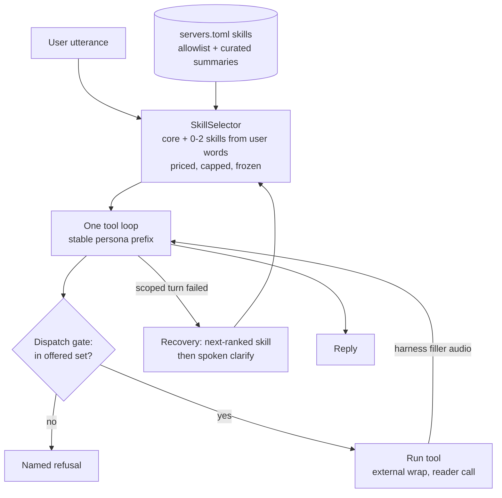

# Tool exposure at scale (DRAFT v2, awaiting sign-off)

## Problem

The boot gate (`core/prompt_budget.py`) prices the system prompt, every
registered tool, the retained-external ceiling and the reply reserve against
`llm.num_ctx`. With calendar-mcp enabled (33 tools, 5512 tokens), that total
came to 18560 against 16384, so GLaDOS refused to start.

The gate has to price every tool because capability recovery
(`core/organizer.py` around line 1600) re-drives a failed scoped turn on the
FULL tool set. Every new MCP server makes this worse, so trimming one server
only postpones the problem.

## How the decision was made

Two roster rounds were run. Each had five seats: architect, security,
concurrency/QA, small-model/latency, and clean-slate. Round 2 compared three
designs:

1. **Option A:** one loop, plus a tool selector, plus a `find_tools`
   meta-tool.
2. **Option B:** domain sub-agents that run the tool loop and hand a digest
   back to the organizer.
3. **Any hybrid.**

All five seats landed independently on the same design, written below as
option C. Both A's `find_tools` and B's sub-agents were dropped from the core
design. The section "Rejected, and what would bring them back" says why.

## Design: one loop, harness-routed domain skills

The invariants:

- **The model never chooses which tools exist in a turn.** The harness
  chooses, from the user's own words, before the first LLM call.
- **The worst-case prompt depends on the cap, not on how many servers are
  installed.**

1. **Skill = the domain unit.** Each server gets a skill block in
   servers.toml. The block holds:
   - `expose_tools`: an allowlist. It is required for untrusted servers, and
     there is no exclude-list.
   - A curated one-line summary per tool. Server-authored descriptions are
     never used for ranking and never echoed back to the model.
   - Intent keywords and, later, exemplars.
   - A trust level.
   - An optional short domain prompt fragment.

   Boot logs the tools it hides, warns when the allowlist names a tool the
   server does not have, and pins a hash of each description.
2. **SkillSelector** (in `brain/`, grown from `ToolRouter`). Before hop 1 it
   picks the core tools plus 0-2 skills from the user's utterance, under
   `llm.tool_budget_tokens`. Ranking starts as keywords, moves to BM25, and
   later to embeddings, all behind one `ToolRetriever` protocol. A
   recently-used skill stays sticky for follow-ups such as "move it to 5".

   The result is the same `specs` list that `_drive` already takes, frozen
   for the whole turn (ARCH section 7 is kept, not amended). The selector
   measures the serialized tool block with the real pricer and fails closed
   above the cap.
3. **One loop.** `_drive` stays the only tool loop. Confirm flows, the write
   ledger, cart verify, barge-in cancellation, history and the reader call
   all stay as they are, because none of them sees how the specs were
   chosen.
4. **The dispatch gate refuses any tool not in this turn's offered set.** The
   refusal is named, never a silent drop. This closes calls copied from
   history and calls steered by injection.
5. **Capability flags.** Mutating and money tools are offered only when the
   user's utterance carries action intent for that skill. Tool-result text
   never feeds selection. The `money_step` tools keep their harness-voiced
   confirm, read back from structured data.
6. **Recovery is deterministic.** A failed scoped turn re-drives once with
   the next-ranked skill swapped in, under the same cap and freeze, and never
   on the full set. The existing `may_have_mutated`, `said_nothing`,
   `budget_exceeded` and `confirm_refused` guards are kept. If nothing scores,
   GLaDOS asks a spoken clarifying question ("Calendar or shopping?").
   Every abstain is logged and traced as a miss, never as a success.
7. **Latency.**
   - Prompt order: the persona prefix stays first and stable, so Ollama's KV
     cache keeps it; the tool block and the domain fragment follow it.
   - Filler: when the harness parses the first tool call it plays a canned,
     pre-rendered line per domain ("Checking your calendar."). It costs no
     tokens and no extra hop.
8. **Boot proof:**

   `system + max speaker suffix + max domain fragment + core +
   tool_budget_tokens + retained external + reply <= num_ctx`

   Boot refuses, by name, any skill that alone is larger than the cap. The
   drift monitor prices each actual send.
9. **Untrusted bulk** goes through the existing reader call, applied per
   skill. Ids stay verbatim in the structured result and are never digested.
   This is how raw bytes are kept out of the persona context without a second
   agent.

## Rejected, and what would bring them back

- **`find_tools` meta-tool.** It adds an LLM hop, relies on a query the 8B
  model writes, and gives untrusted content a channel that widens scope. It
  comes back if real-use abstain rates exceed about 10% AND Ministral picks
  correctly with it at 90% or better.
- **Domain sub-agents (B).** On one GPU, each prompt swap re-prefills
  (estimated 1-2.5 s each), so a tool turn costs four hops instead of two.
  Digests lose ids. Confirm, ledger, cancellation and recovery would have to
  be rebuilt across an agent boundary. And because the same model reads the
  raw bytes and holds the write tools, the isolation is mostly illusory.

  B comes back if the bake-off shows tool and argument accuracy failing with
  even one bundle loaded, and a focused sub-agent prompt fixing it by 10
  points or more at under 1.5 s added. The skill interface lets one domain be
  upgraded to a sub-agent later without touching the rest.

## Slices (none is throwaway)

- **S1:** calendar `expose_tools` allowlist (about 10 voice verbs). The gate
  is unchanged; the total is about 14.7k tokens. Then the prod enable and the
  G1 check.
- **S2:** dispatch gate on the offered set, plus per-send drift pricing.
- **S3:** SkillSelector, the cap, the new boot proof, and deterministic
  recovery with the spoken clarifying question. The full-set re-drive is
  deleted.
- **S4:** curated skill index (summaries, trust, sticky skill) and
  capability flags.
- **S5:** harness filler audio and domain fragments, kept only if the
  bake-off supports them.
- **S6:** bake-off. It runs on every live model surface with a restart
  between arms, about 80 utterances: single-domain, compound, follow-up,
  paraphrased misses, and injected calendar text. Arms compare the persona
  prompt against a tool-only suffix. It measures:
  - right tool and right arguments,
  - confabulation,
  - hops,
  - time to first and to final audio,
  - `prompt_eval_count`,
  - injected dispatches, which must be 0.
- **Later, security should-fix:** per-value provenance tags (domain and
  room), and a cross-domain sink rule: calendar-tainted values are refused as
  Dunnes write arguments.
