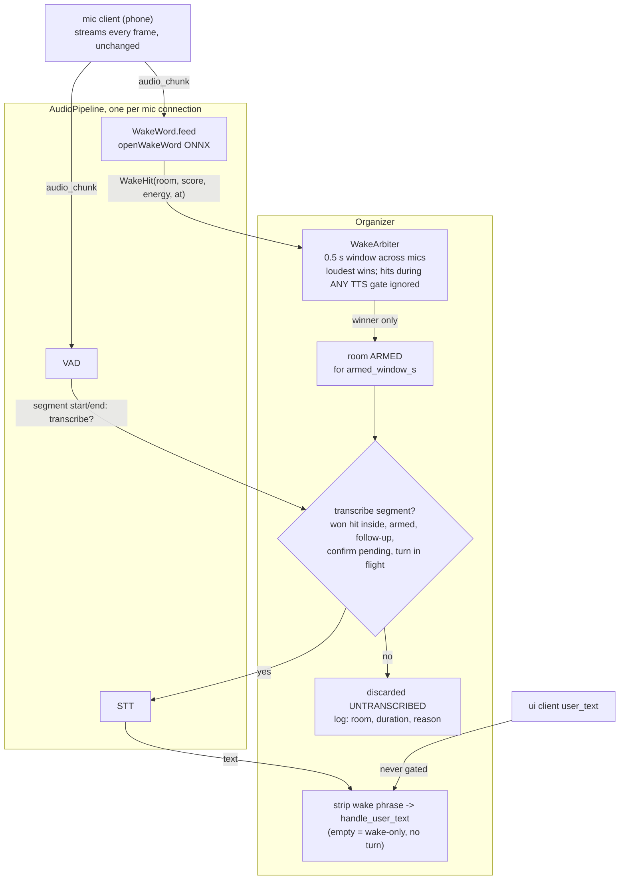
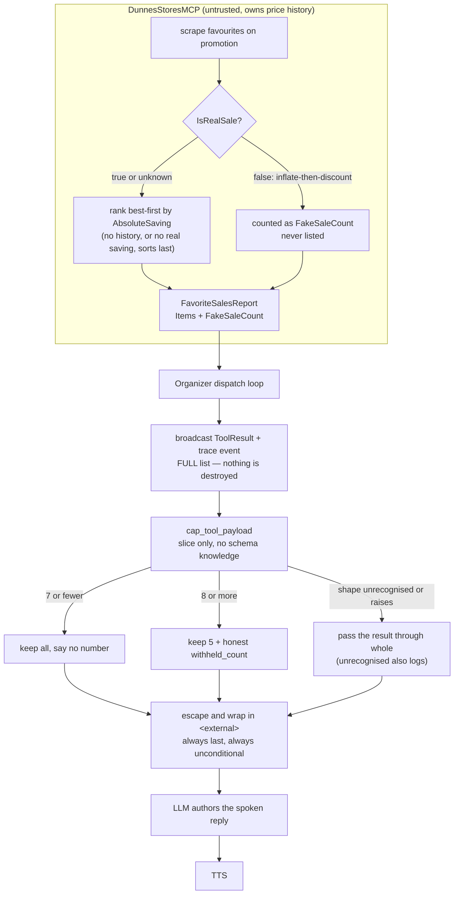
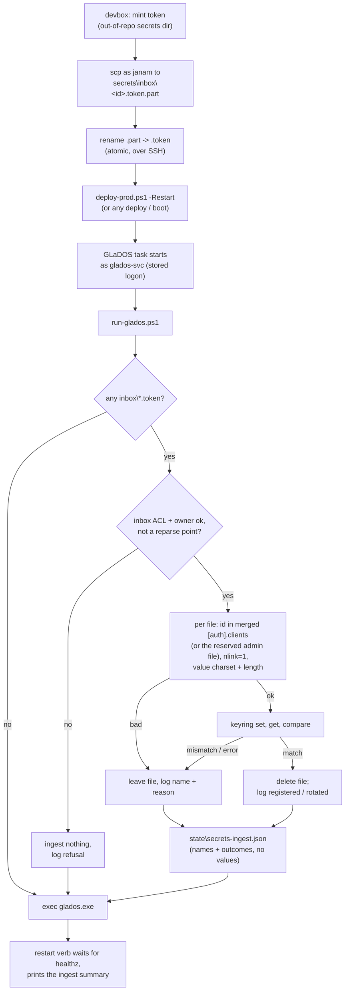

# DESIGN - wake word ("Hey GLaDOS") and cross-room wake arbitration

Status: revised after roster, awaiting user sign-off (17-10-2026). ARCH section 12 v4.

## The problem

Every utterance the VAD closes on any mic becomes a turn. A TV, a phone call,
or two people chatting in the kitchen all reach the LLM. With a second room
online, one spoken command heard by two mics runs twice. ARCH section 3 item 2
promised dedup; it was never built.

## Decisions (revised after the design roster, 17-10-2026)

1. **Detection runs on the server, one detector per mic connection** -- not on
   the phone. The phone already streams every frame (dumb client, ARCH 2);
   Termux has no reliable onnxruntime; every hit lands on one server clock, so
   arbitration is a comparison, not a clock-sync problem. Clean-slate seat
   reached the same shape independently (verdict: keep-and-patch).
2. **`WakeWord` adapter mirrors `VAD`**: sync `feed(pcm) -> list[float]`
   (scores above threshold) + `reset()`. The pipeline turns a hit into
   `WakeHit(client_id, room_id, score, energy_dbfs, at)`: `at` is the frame's
   ARRIVAL time taken before inference; `energy_dbfs` comes from a ~1 s RMS
   ring buffer in the pipeline; `room_id` is the SERVER-side binding, never a
   client field. Inference runs on a single-worker executor per pipeline
   (ordered per connection, off the event loop); bounded, drops logged. A
   per-pipeline 1.5 s cooldown collapses the burst of hits one phrase makes.
   ARCH 6's async `listen()` sketch is replaced. Backends: `openwakeword`,
   `fake` (scripted by frame index).
3. **Gate BEFORE STT, not after (privacy, ARCH 9).** The pipeline asks the
   Organizer at VadEnd whether to transcribe the segment: yes if a winning hit
   for this connection lies in `[vad_start, vad_end]`, the room is armed, its
   follow-up window is open, a confirm is pending, or a turn is in flight
   (barge-in). Otherwise the segment is discarded untranscribed and the drop is
   logged as room + duration + reason -- never text, no trace. Conversations
   GLaDOS was not addressed in are never written down.
4. **Admission is an interval test over stored wins.** Each room keeps its
   recent winning hits (pruned after `armed_window_s`, default 8 s) and its
   lost hits. Segment admitted if `start in [win.at, win.at + armed]` or
   `win.at in [start, end + 0.3 s]`. A segment containing a LOST hit is dropped
   even if a follow-up window is open (the losing room never runs the command).
   The pipeline passes `(text, start_at, end_at)`.
5. **Winning mic owns the room** from the win until the follow-up window
   closes; other mics in that room are not admitted meanwhile (two-mic rooms
   run a command once).
6. **Wake-only segment arms, starts no turn.** The phrase is stripped from the
   transcript by a pure helper over configured aliases incl. Whisper spellings
   ("hey glados", "hey gladys", "hey jarvis" for the stand-in), with a test
   corpus. Empty after strip -> no turn.
7. **Follow-ups without re-wake** for `followup_window_s` (6 s) after a
   room's `last_turn_end` (own per-room stamp, not gate internals). A wake in
   the window extends it. Barge-in and confirm answers keep today's rules;
   confirm stays restricted to the room's own mic role.
8. **Cross-room arbitration (WakeArbiter, pure class, injected clock/timer).**
   First hit opens a 0.5 s window (widened from ARCH 3's 0.3 s for LAN
   arrival jitter); best hit per connection kept; winner = highest
   `energy_dbfs + room gain offset` (score breaks ties). Losers logged with
   room/score/energy, no text. Global by default; acoustic zones are a later
   add if two separate rooms ever wake within 0.5 s.
9. **Self-wake guard: a hit while ANY room's TTS gate is closed is ignored.**
   Covers GLaDOS's voice from the kitchen waking the living room. Cost: you
   cannot wake GLaDOS while she is speaking anywhere -- "stop" still works.
10. **Wake admission is not authorisation.** Mutating tools keep the ARCH 3 /
    DESIGN-voice-confirm gate unchanged. Admitted turns record why
    (armed / one-breath / follow-up / confirm / barge-in) in the trace.
11. **Rollout and failure.** `[wake] mode = "off" | "required"` in
    glados.toml (default `off` = today), per-room `wake_mode` override in
    rooms.toml; rooms with `off` do not enter arbitration. No runtime model
    download: model path + pinned sha256 in config, checked at boot; a missing
    or mismatched model when any room is `required` fails boot. A runtime
    detector fault in a `required` room fails CLOSED (nothing admitted but
    barge-in, logged loudly) -- never falls back to always-listening.
12. **Prototype first.** Ship with openWakeWord's pretrained "hey_jarvis" in
    the kitchen only; the custom "hey_glados" model is a later file swap
    (training on the devbox GPU, queued behind tracks 3/4).
13. **UI `user_text` is never gated.**

## Deliberately not built (known-issue list)

- Earcon / "listening" cue on wake.
- Waking GLaDOS mid-reply ("Hey GLaDOS, stop") -- excluded by decision 9;
  "stop" covers it.
- Audio-trim of the wake phrase before STT (text strip first; trim if the
  alias strip proves leaky).
- Capture-clock timestamps from client sample counts (client drop-oldest
  queue makes the count drift); revisit if 0.5 s proves too narrow.
- Acoustic zones; per-room thresholds; phone-side detection.
- Custom "hey_glados" training (own slice, GPU queue).

## The flow

---

# DESIGN — spoken-length cap on tool results

## The problem

A voice reply is read start to finish. The listener cannot skim, cannot jump to
the interesting line, and cannot go back. So when `scan_favorites_for_sales`
returns a dozen items on promotion, GLaDOS speaks a dozen items — and the user
has to sit through all of them to learn there were two worth hearing.

Capping the reply by asking the model for brevity does not work: small local
models follow such instructions unreliably, and the failure is silent. Capping
the PAYLOAD is deterministic — the model cannot name an item it never received.

## Where the work is split, and why

Two repos, one seam each.

**The Dunnes MCP server ranks and filters.** It owns the price history, so it is
the only party that can compute a saving or judge a promotion. It sorts
best-first by `AbsoluteSaving` (euro off the historical median), drops items
that fail the `IsRealSale` test, and reports how many it dropped as
`FakeSaleCount`. It returns the FULL ranked list.

**GLaDOS slices.** It takes the first N and counts the rest. It reads no field
of the Dunnes schema — only "is this a list, and how long is it". This is the
line `ARCHITECTURE.md` §7 draws: GLaDOS does not parse another repo's payload
in the code path that handles hostile bytes.

The alternative — capping inside the .NET server — was rejected because the
withheld items would then never reach GLaDOS at all, and the desk client and
`traces/` would lose data they show today.

## Why euro, not percent

A third off a yoghurt is small change next to a tenth off a joint of beef.
Percent flatters cheap items; the listener cares about money. The saving is the
SORT KEY only — it is never spoken, because saying "down from eight, saving two"
after every item roughly triples the length and reintroduces the problem the cap
exists to solve.

## The flow

## Invariants the implementation holds

1. **The cap runs downstream of the broadcast and the trace.** It narrows what
   is SPOKEN, never what is recorded. The full list stays in the desk client and
   in `traces/`, so the withholding is recoverable by the user.
2. **The `<external>` escape and wrap stay terminal and unconditional.** The cap
   rebuilds the payload, so the defang is applied to the cap's output, not to
   the bytes the server sent.
3. **The cap emits JSON values, never prose.** A scraped name inside a JSON
   string literal is a quoted datum; the same name formatted into a sentence is
   free-running text sitting where a sentence goes. The LLM writes the prose.
4. **`withheld_count` is derived from the list actually sliced.** Computing it
   from a raw total would offer items the server already filtered out — a
   confabulation authored by the harness itself.
5. **The cap never fails a turn.** Any unexpected shape or exception passes the
   result through untouched. The tolerable failure is today's long list; a
   silent "nothing found" is not, because it reads exactly like the truth.
6. **GLaDOS never offers what it cannot deliver.** The withheld items are not
   retained, so the reply states how many more exist and stops. The system
   prompt says so explicitly, because a bare `withheld_count` the model has to
   interpret is either ignored or read aloud as a key name.

## What the ranking cannot do

There is no purchase-frequency data anywhere in the Dunnes server — only an
`IsPastPurchase` boolean scraped from a badge. "The five we buy most" is not
computable today. The favourites list is itself the coarse frequency filter,
since the scan only ever looks at items the user chose to favourite.

## Deliberately not built

**Delivering the withheld remainder.** GLaDOS says how many more there are and
stops; "yes, tell me the rest" is not yet answerable. A remainder cache was
built and then removed, because retaining items with no path to speak them is a
store that can only ever go stale — and an offer the system cannot honour is the
confabulation shape this project has logged repeatedly.

When it is built, the design is already argued: cache the remainder rather than
re-scraping (`scan_favorites_for_sales` has a 35 s timeout and there is one
worker per room, so "yes" would buy 35 seconds of dead air and block every later
utterance in that room), key it by session, bound its lifetime to the same
commit decision as the conversation history, and drop it on barge-in — GLaDOS
cannot know which items were actually heard before an interruption.

---

# DESIGN - registering client tokens without the service password

## The problem

A client token must land in **glados-svc's** keyring (Windows Credential
Manager, DPAPI-protected by that account's password). Today that means RDP plus
`runas /user:glados-svc` with a password nobody remembers, and an admin reset of
that password destroys every stored secret. The one thing on the box that
already runs as glados-svc, with no password typed, is the `GLaDOS` scheduled
task. So the task's own launcher does the registering.

## The flow

## Decisions

- **Where it runs: a pre-step in `run-glados.ps1`** calling
  `python -m glados.secrets ingest <inbox>`. It inherits the task's logon, so
  it writes the vault the server reads. The server process gains no code.
- **Bounded and fail-open.** Started as its own process with a 30 s timeout,
  killed on expiry, wrapped so any failure (crash, older release without the
  subcommand after a rollback, nonzero exit) falls through to starting the
  server. Skipped entirely when the inbox holds no `*.token`.
- **Fail closed on the inbox, not the boot.** Inbox DACL must be exactly
  Administrators F, SYSTEM F, glados-svc read + delete (set explicitly by
  bootstrap, no inheritance); owner Administrators/SYSTEM/an admin; dir and
  files not reparse points; files with link count 1. Any mismatch ingests
  nothing. glados-svc cannot create files there.
- **Allowlist from the merged config** (`load_glados_config` with the local
  overlay, same as the server). Unknown ids stay in place and are logged.
  Overwriting an existing id is rotation: allowed, logged as `rotated`.
- **Value checks:** one trailing newline stripped, then a fixed charset and
  length bound; never echoed, not even a prefix.
- **Write order:** set, get, constant-time compare, then delete. A failed delete
  after a good store is a WARN (a token left at rest); the next run is
  idempotent.
- **Scope:** `client-tokens`, plus exactly one reserved file,
  `admin.observe-token.token` -> `admin`/`observe-token`, the secret of the
  loopback admin room viewer (prod launcher sets `GLADOS_ADMIN_PORT=9765`).
  Matched by exact name, never a widened pattern: client ids cannot contain a
  dot, so it cannot collide with a client, and other dotted names are ignored.
  It skips only the `[auth].clients` check; link, regular-file and value checks
  still apply. Rotation = ingest + restart: auth is checked once per handshake,
  so a viewer opened with the old secret stays open until the restart. View it
  only through a loopback SSH tunnel (`ssh -L 9766:127.0.0.1:9765 <prod>`),
  never `-g` or a non-loopback bind.
- **Trigger:** the existing `restart` verb; no new verb. `status` and `restart`
  print the last ingest summary.
- **Recovery after a forced password reset:** drop every token in the inbox,
  restart. Same path.
- **`set-client-auth.ps1`** is kept as a documented fallback (needs the
  password), not the primary path.

## Deliberately not built

- **Hashed verifiers instead of keyring tokens** (the clean-slate seat's pick):
  the server only verifies client tokens, so it could store sha256 in an
  admin-ACL'd file and need no secret at rest. Real merit, but it changes ARCH
  section 9 and requires re-minting every client; parked as its own decision.
- **A second scheduled task as glados-svc** (needs the password once) and
  **S4U** (believed unable to unlock Credential Manager; unverified).
- **A live, no-restart trigger** (inbox watcher in the server, or the admin
  loopback API): only reachable from inside the server process; not worth it
  for a rare operation.
